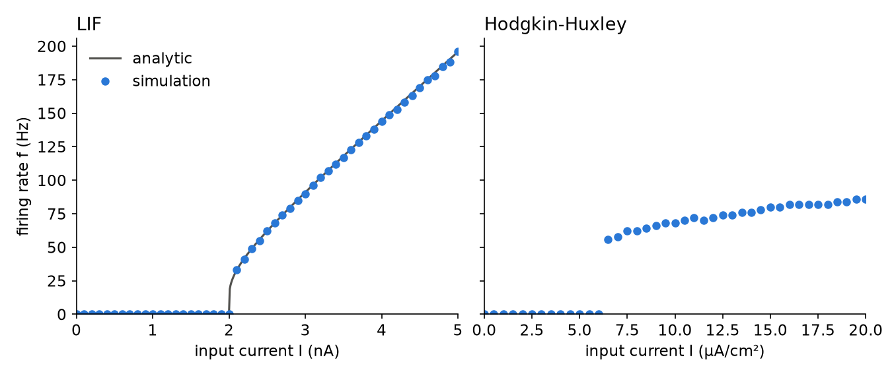
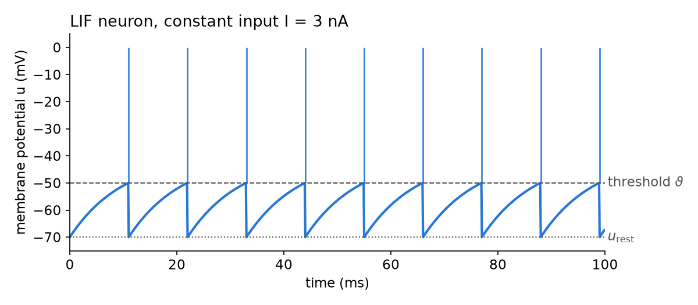
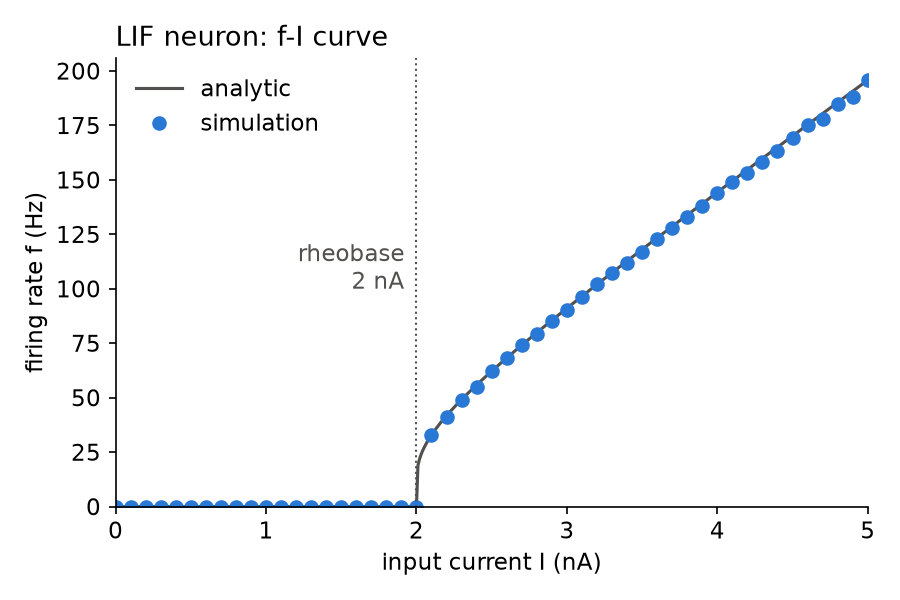
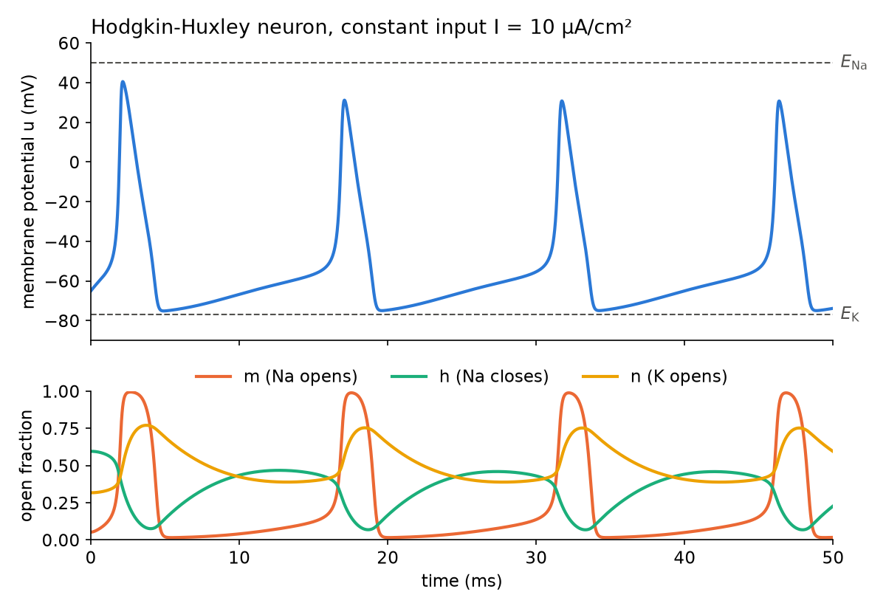
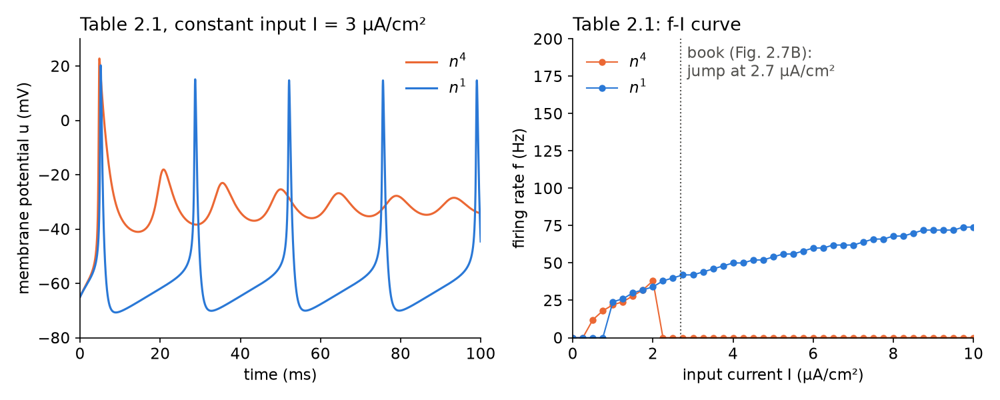

# 01 · From RC circuit to spike

## Question
How does a neuron turn a constant input current into spikes, how can this be
described mathematically, and how does the firing rate depend on the current?

## Key result

The firing rate of the leaky integrate-and-fire (LIF) neuron rises continuously
from 0 Hz once the current passes the rheobase of 2 nA ("type I"). The
Hodgkin-Huxley (HH) neuron stays silent up to 6.0 µA/cm² and then jumps straight
to 56 Hz ("type II"): its sodium and potassium gates act as delayed negative
feedback and give it a rhythm of its own. An appendix tests the book's cortical
HH parameters, which reproduce the book's figure only in part.

## Model
Two neuron models from Gerstner et al., *Neuronal Dynamics* (2014). No data are
needed; everything is simulated in [`neuron_models.ipynb`](neuron_models.ipynb)
(Python 3.14, numpy, matplotlib; versions in
[`requirements.txt`](../requirements.txt)).

- **Leaky integrate-and-fire (LIF)**, Sect. 1.3. The membrane is an RC circuit
  with a battery: the lipid bilayer is the capacitor, the ion channels are the
  resistor. A spike is a threshold crossing followed by a reset.

  $$\tau_m \frac{du}{dt} = -[u(t) - u_\mathrm{rest}] + R\,I(t) \qquad (1.5)$$

  Parameters: u_rest = −70 mV, threshold −50 mV, reset −70 mV, R = 10 MΩ, τ_m = 10 ms.

- **Hodgkin-Huxley (HH)**, Sect. 2.2. Sodium and potassium channels whose gates
  (m, h, n) open and close at voltage-dependent rates. Spikes come out of the
  equations; there is no threshold and no reset. Original squid-axon parameters
  (Hodgkin & Huxley, 1952), resting potential −65 mV.

## What I did
1. Worked through the theory in *Neuronal Dynamics* (Sect. 1.3 and 2.2).
2. Solved the LIF equation step by step with the Euler method (dt = 0.1 ms) and
   plotted the voltage trace with its spikes.
3. Compared the simulated interspike interval with the analytical solution.
4. Computed the LIF f-I curve (firing rate vs. input current) and compared it
   with the analytical rate.
5. Simulated the HH model with the Euler method. The time step is ten times
   smaller (dt = 0.01 ms), because the sodium gate m reacts within 0.1–0.4 ms.
6. Computed the HH f-I curve and compared it with the LIF curve.
7. Checked the HH time step: halving dt leaves the firing rates unchanged.
8. Tested whether the book's cortical HH parameters (Table 2.1) reproduce its
   f-I curve (Fig. 2.7B); see the appendix of the notebook.

## Results

### LIF neuron

At 3 nA the neuron fires 9 spikes in 100 ms. Between spikes the voltage rises
more and more slowly, because the leak current grows as u moves away from rest.
Interspike interval: 11.00 ms in the simulation, 10.99 ms analytically.

Below the rheobase of 2 nA the neuron is silent; above it, the rate rises
continuously from 0 Hz. Simulation and analytical rate agree.

### Hodgkin-Huxley neuron

At 10 µA/cm² the first spike peaks at +40 mV and the following ones at about
+31 mV, below the sodium reversal potential of +50 mV; each is followed by an
undershoot to about −75 mV. The gates show the
mechanism: m opens sodium quickly; h closes it and n opens potassium with a delay.

Time step check (firing rate in Hz):

| I (µA/cm²) | dt = 0.02 ms | dt = 0.01 ms | dt = 0.005 ms |
|---|---|---|---|
| 6.0 | 0 | 0 | 0 |
| 6.5 | 56 | 56 | 54 |
| 10 | 68 | 68 | 68 |
| 20 | 86 | 86 | 86 |

Rates are counted over 0.5 s, so they are resolved to 2 Hz; right at the jump
(6.5 µA/cm²) the smallest step differs by one spike.

### LIF vs. HH: why the jump
The main figure is shown under "Key result" at the top. The LIF curve starts
continuously at 0 Hz; the HH curve jumps from 0 to 56 Hz between 6.0 and
6.5 µA/cm².

Why: the LIF neuron has no rhythm of its own, only a charging time to the
threshold, and this time becomes arbitrarily long as the current approaches the
rheobase. The HH neuron has its own rhythm through delayed negative feedback:
h closes sodium and n opens potassium, both a few milliseconds late. Below the
jump the voltage rings and dies out; above it, the neuron fires straight away
at this rhythm. A jump like this is called "type II" (Sect. 2.2 and 4.4).

The current axes cannot be compared: nA flow into a whole neuron, µA/cm² into a
patch of membrane, and the two models are different cells. Only the shape of
the curves is comparable.

### Appendix: the book's cortical parameters

The book also gives HH parameters for cortical neurons (Table 2.1) and their
f-I curve, which jumps at 2.7 µA/cm² (Fig. 2.7B). The printed parameters
reproduce this only in part:

- The table's rate functions match the book's own Fig. 2.3 (for example
  τ_h peaks at 20.6 ms near −62 mV), so the table itself is consistent.
- With the potassium current as printed in Eq. (2.5), proportional to n⁴,
  potassium hardly opens (n⁴ ≈ 10⁻¹³ at rest). Nothing brakes the voltage after
  a spike, and above 2 µA/cm² the membrane stays stuck near −30 mV instead of
  firing (orange).
- In the published code of the channel model the table takes its rates from
  (Mainen et al.; ModelDB 2488), the potassium conductance is proportional to n.
  With n¹ the spike shape and the jump come back (blue), but the jump lies
  between 0.75 and 1 µA/cm² instead of at 2.7 µA/cm², and the rate at
  10 µA/cm² is 74 Hz instead of more than 200 Hz.

Halving dt does not change the n¹ rates. The remaining difference probably comes
from details of the book's simulation that are not given in the text.

## What I learned
- My biggest moment was when I understood the Hodgkin-Huxley equations and
  their ringing. At first I found them complicated and did not see why there
  is a jump.
- The LIF model made it easy to see the threshold, and that is how I was
  introduced to the concept. So I assumed it was a concrete, fixed voltage.
  Through HH I learned that it is not: it comes from a complex interplay of the
  gates and the neuron's own rhythm. Real neurons, too, have no single fixed
  threshold: it is not one concrete number but depends on the input.
- I found the Table 2.1 check very confusing, and it surprised me. I know that
  in real research, too, strange open questions sometimes come up that do not
  get resolved.
- In its simplest form, the fundamental principle behind neurons is simple. At
  the same time, neurons are extremely complex, and here we have simplified
  them strongly.

## Limits and next steps
- Only constant input current; real neurons receive fluctuating input from
  thousands of synapses.
- HH uses squid-axon parameters, not those of a cortical neuron. The book's
  cortical parameters reproduce the jump of Fig. 2.7B only in part (see the
  appendix above).
- LIF has no spike shape, no refractory period and no adaptation (Sect. 1.4).
- Coarse resolution: currents in steps of 0.5 µA/cm² (0.25 µA/cm² in the
  appendix), rates resolved to 2 Hz.
- Next: give both models a noisy input and test whether the HH jump survives;
  find the missing detail that moves the cortical jump from about 1 to
  2.7 µA/cm².

## How this was built
The code was drafted mostly by Claude Code (see the
[top-level README](../README.md)). My part: the LIF Euler step and the HH
potassium current, predictions before running cells, the checks against the
analytical solution and the textbook, and the interpretation. For the Table 2.1
appendix, which Claude ran for the most part, I asked whether our own code could
be the cause and decided to stop after a time box and report a partial
reproduction.

## References
- Gerstner, W., Kistler, W. M., Naud, R., & Paninski, L. (2014). *Neuronal
  Dynamics: From Single Neurons to Networks and Models of Cognition.* Cambridge
  University Press. https://neuronaldynamics.epfl.ch
- Hodgkin, A. L., & Huxley, A. F. (1952). A quantitative description of membrane
  current and its application to conduction and excitation in nerve.
  *J. Physiol.* 117, 500–544.
- Mainen, Z. F., Joerges, J., Huguenard, J. R., & Sejnowski, T. J. (1995). A
  model of spike initiation in neocortical pyramidal neurons. *Neuron* 15,
  1427–1439.
- Mainen, Z. F., & Sejnowski, T. J. (1996). Influence of dendritic structure on
  firing pattern in model neocortical neurons. *Nature* 382, 363–366. Model code:
  ModelDB entry 2488, https://modeldb.science/2488
