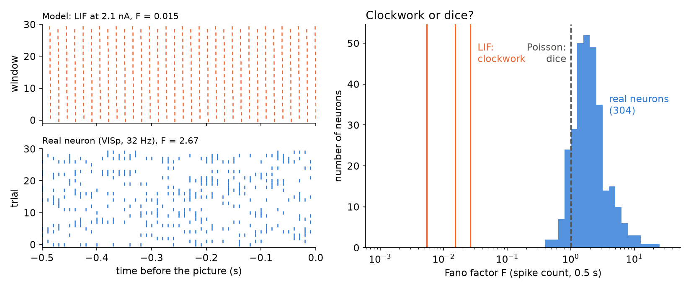
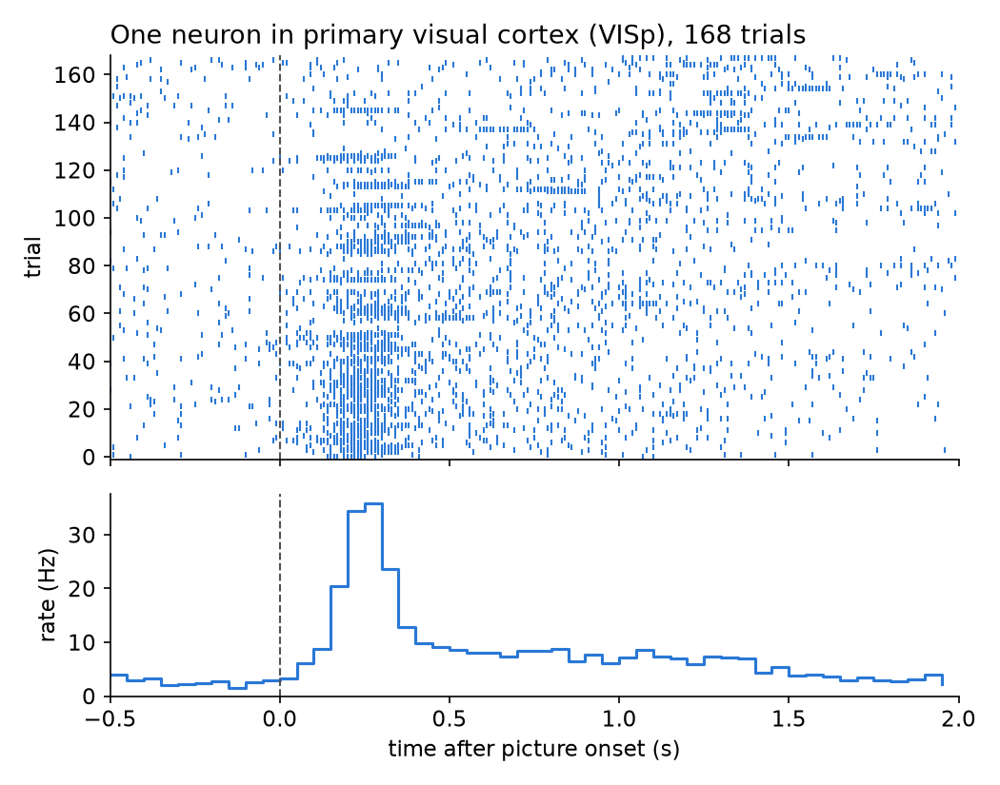
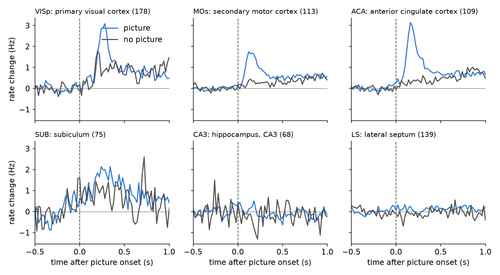

# 02 · How real neurons fire

## Question
How differently do real neurons fire from the textbook ideal of the LIF model:
how often, and how regularly?

## Key result

Driven by a constant current, the leaky integrate-and-fire (LIF) neuron of
[project 01](../01-neuron-models/) fires like clockwork: at 2.1 nA (33 Hz) its
spike count in a 0.5-s window changes by at most one spike, and its Fano factor
is 0.015. A neuron in the mouse's primary visual cortex with almost the same rate
(32 Hz) has F = 2.67. Over all 304 neurons that fire at least 2 Hz, the median
is 1.87, and 88 % lie above 1, the value for a Poisson process. Real neurons are
not only far from clockwork; their counts vary even more than random spiking at
a fixed rate would allow, which suggests that the rate itself changes from trial
to trial.

## Data
Neuropixels recordings from mice doing a visual task (Steinmetz et al., 2019),
in the preprocessed version of Neuromatch Academy. A striped picture appears on
the left and/or right screen, and the mouse turns a wheel to bring the picture
with the higher contrast to the centre; without a picture it should hold the
wheel still. Probes record spikes in many brain areas at once.

I use one session (mouse "Cori"): 734 neurons (716 of them in seven identified
brain areas), 214 trials
(168 with a picture, 46 without), spike counts in 10-ms bins from 0.5 s before
to 2 s after the picture. The notebook
[`real_neurons.ipynb`](real_neurons.ipynb) downloads the data file (88 MB, Open
Science Framework) into `data/`; the data are not part of the repository.
Python 3.14, numpy, matplotlib (versions in
[`requirements.txt`](../requirements.txt)).

Two tools from *Neuronal Dynamics* (Gerstner et al., 2014):

- **PSTH** (peri-stimulus time histogram), Sect. 7.2.2: the spike counts of
  K trials, summed per time bin and divided by K and the bin width Δt, give the
  firing rate over time.

  $$\nu(t) = \frac{1}{K\,\Delta t}\sum_{k=1}^{K} n_k(t) \qquad (7.9)$$

- **Fano factor**, Sect. 7.2.1: how much the spike count n in a window varies
  from trial to trial. Clockwork gives F = 0, a Poisson process F = 1.

  $$F = \frac{\langle(\Delta n)^2\rangle}{\langle n\rangle} = \frac{\text{variance of the count}}{\text{mean count}} \qquad (7.2)$$

## What I did
1. Worked through the PSTH and the Fano factor in *Neuronal Dynamics*
   (Sect. 7.2).
2. Downloaded the data and wrote the PSTH line myself
   (`rate = counts.sum(axis=0) / (K * bin_width)`). A units check caught a
   double division that gave 2500 Hz instead of 35 Hz.
3. Picked an example neuron in the primary visual cortex (VISp): the one whose
   rate rises most among the neurons that fire below 5 Hz before the picture.
   Drew its raster plot and PSTH.
4. Compared the mean response of six brain areas in trials with and without a
   picture, and timed the motor-cortex response against the mouse's reaction
   time on the wheel.
5. Computed the Fano factor of every neuron in the 0.5 s *before* the picture,
   when all trials are the same condition, and compared it with the LIF neuron
   of project 01 at three currents. Checked it per area and for shorter windows.
6. Followed up two things I noticed: the response fades over the session, and
   VISp rises a little even without a picture.

## Results

### One neuron sees the picture

The example neuron fires 2.7 Hz before the picture and 17.5 Hz in the first
response window (0.05–0.25 s); its PSTH peaks at about 35 Hz, 0.2–0.3 s after
the picture. Neurons like this are rare: only 31 of the 178 VISp neurons rise
by more than 2 Hz.

### Which brain areas respond

The primary visual cortex (VISp), the secondary motor cortex (MOs) and the
anterior cingulate cortex (ACA) respond to the picture: their mean rate rises
above the trials without a picture, by up to about 3 Hz. The hippocampus (CA3)
and the lateral septum (LS) do not respond, and the subiculum (SUB) changes in
both conditions alike.

MOs peaks 0.12–0.15 s after the picture, but the mouse starts to turn the wheel
only after a median of 210 ms (128 trials). The peak comes before the movement
in most trials, so it looks more like preparing or choosing the movement than
executing it. What ACA does here, this analysis cannot tell.

### Clockwork or dice?
The main figure is shown under "Key result" at the top. Left: the LIF neuron at
2.1 nA and the VISp neuron with the closest rate, in the 0.5 s before the
picture. Right: the Fano factors of all 304 active neurons.

| | Rate | Count per 0.5 s | Fano factor |
|---|---|---|---|
| LIF, 2.01 nA | 19 Hz | 9 or 10 | 0.026 |
| LIF, 2.1 nA | 33 Hz | 16 or 17 | 0.015 |
| LIF, 3.0 nA | 91 Hz | 45 or 46 | 0.005 |
| real neurons (304) | ≥ 2 Hz | varies | median 1.87, 88 % > 1 |

The LIF neuron is fully deterministic. Its Fano factor is not exactly zero only
because the windows cut its regular rhythm at different points, so the count is
N or N+1. That variance is at most 0.25 for every current, while the mean count
grows with the rate, so F gets smaller at higher currents.

The real neurons vary more than a Poisson process. Per brain area, the median
lies between 1.44 (LS) and 2.39 (MOs). The Fano factor also grows with the
window length: 1.31 at 0.1 s, 1.60 at 0.25 s, 1.87 at 0.5 s. For a Poisson
process with a fixed rate it would stay at 1. Slow changes of the rate from
trial to trial predict this growth, because a rate difference adds up over a
longer window faster than the counting noise does.

### Two open observations
**The response fades over the session.** I split the trials with a picture
into three parts in time order:

| Part of the session | Response of the 31 VISp neurons | Mouse turns the wheel |
|---|---|---|
| first third | +8.3 Hz | 96 % |
| second third | +4.4 Hz | 77 % |
| last third | +1.3 Hz | 55 % |

The response falls while the mouse takes part less and less. This points to
engagement rather than the neurons getting used to the picture, but it is a
correlation: slow adaptation over many repetitions would also weaken the
response.

**VISp rises a little without a picture** (about +1.8 Hz at 0.2 s, gray curve
above). My hypothesis was that the mouse expects a picture and learns this
expectation during the session. Then the bump should grow over the session. It
does not: +1.3 Hz in the first half of the trials without a picture, +1.0 Hz in
the second half. It is larger in the 12 trials in which the mouse turns the
wheel anyway (+2.1 Hz) than in the 34 in which it holds still (+0.8 Hz). The
mice were trained on the task before the recordings, so an expectation could be
there from the start; this check only rules out learning within the session.
The cause stays open.

## What I learned
- What surprised me most is how irregular real neurons are. I did not know
  this was possible. It explains a lot about why the brain is so hard to measure
  and to squeeze into our mathematical models: nature is always a lot more
  complex.
- I found it really interesting that we can still see clearly that some of the
  mouse's neurons respond to the picture. It is strange to think that thinking
  is a computation somewhere.
- I was surprised how few neurons respond to the picture at all, and that it is
  not easy to see. I thought there is one clear area for visual processing, with
  lots of neurons responding, because that is how textbooks put it: this area
  processes this information. How exactly it happens, and which neuron does
  what, is always left out, because we cannot say it that precisely.
- Comparing the brain areas was interesting too: some areas did not respond to
  the picture at all. I would not have expected the motor cortex to respond. I
  would have said: if it fires, then because the mouse moves, not because of the
  picture. That the ACA responds as well seems strange to me; I do not
  understand it yet.
- It surprised me that even the LIF neuron has a Fano factor above zero,
  although it should be perfectly deterministic. It makes sense, though: the
  windows cut its regular rhythm, so the count can be off by one spike, the
  ±1 count error I already knew from my physics studies. And it surprised me
  how different real neurons are from the LIF; I thought our model would be
  closer. My guess is that it becomes more accurate on average when you
  look at hundreds of thousands of neurons.
- I expected engagement to show up much more clearly in the data. I still have
  to learn to move from textbook thinking, where everything is clear and
  unambiguous, to research thinking, where nothing is clear and you can only
  rarely conclude something from something. It reminded me of my research for my
  bachelor thesis, where my formulations were always too certain: "X is caused
  by Y."

## Limits and next steps
- One session from one mouse (214 trials, 734 neurons), so I cannot say how
  general these numbers are.
- The LIF neuron is a deliberately extreme reference without any noise, not a
  realistic model of a cortical neuron.
- The interpretations (engagement, movement planning in MOs) are correlations,
  not tested causes. The checks of the gray bump rest on few trials (12 vs. 34).
- The Fano factor depends on choices: the window length and the 2-Hz cut.
- Area averages mix responding and silent neurons.
- Next:
  - Does the extra variance come from how awake the mouse is? The data include
    the pupil size, a common measure of arousal.
  - Planning or executing in MOs: compare trials with a picture in which the
    mouse turns the wheel with those in which it holds still.
  - Why does ACA respond to the picture?
  - Engagement or adaptation: compare late trials in which the mouse still
    turns the wheel with late trials in which it does not. Adaptation predicts
    that both are weak; engagement predicts that the engaged ones stay strong.
  - Repeat everything on the other 12 sessions in the same data file.

## How this was built
The code was drafted mostly by Claude Code (see the
[top-level README](../README.md)). My part: the PSTH line, where a units check
caught an error (2500 Hz instead of 35 Hz); which brain areas respond; the
observation that the response fades while the mouse turns the wheel less often;
and the expectation hypothesis for the bump without a picture. Claude coded the
checks for both observations and the timing check for the motor cortex.

## References
- Gerstner, W., Kistler, W. M., Naud, R., & Paninski, L. (2014). *Neuronal
  Dynamics: From Single Neurons to Networks and Models of Cognition.* Cambridge
  University Press. https://neuronaldynamics.epfl.ch
- Steinmetz, N. A., Zatka-Haas, P., Carandini, M., & Harris, K. D. (2019).
  Distributed coding of choice, action and engagement across the mouse brain.
  *Nature* 576, 266–273.
- Neuromatch Academy, Computational Neuroscience course: preprocessed version
  of the Steinmetz data. https://compneuro.neuromatch.io
