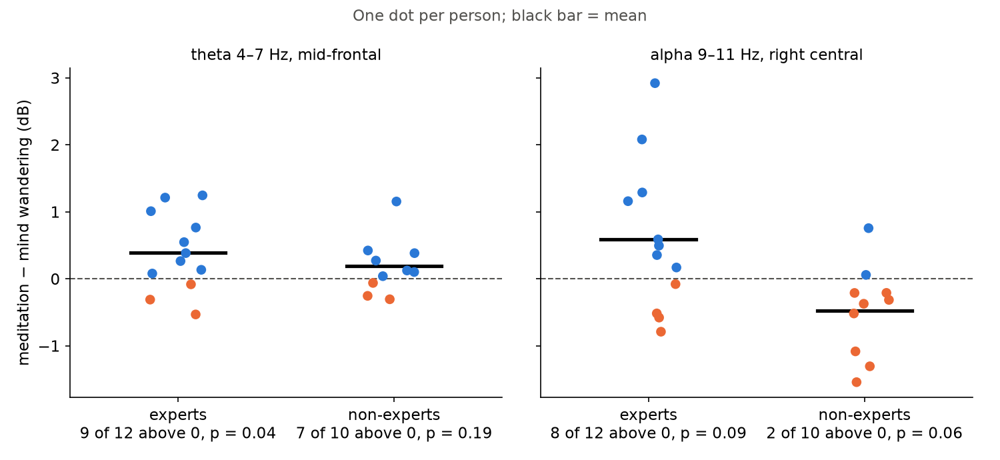
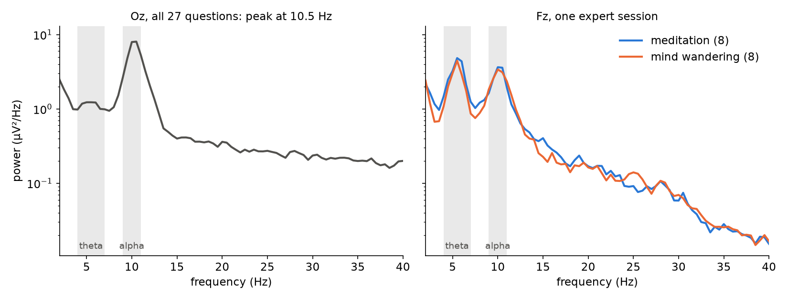
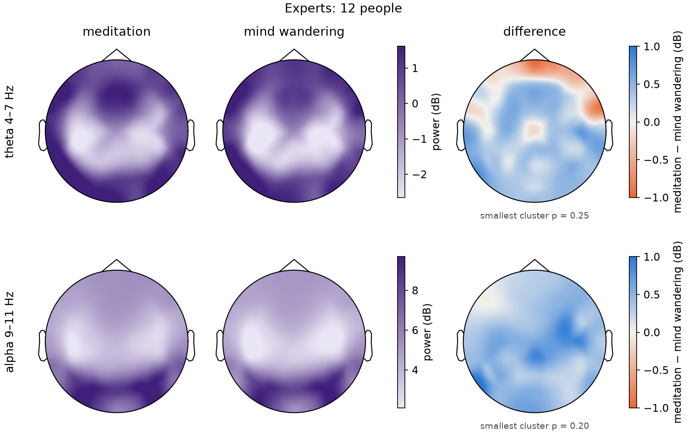
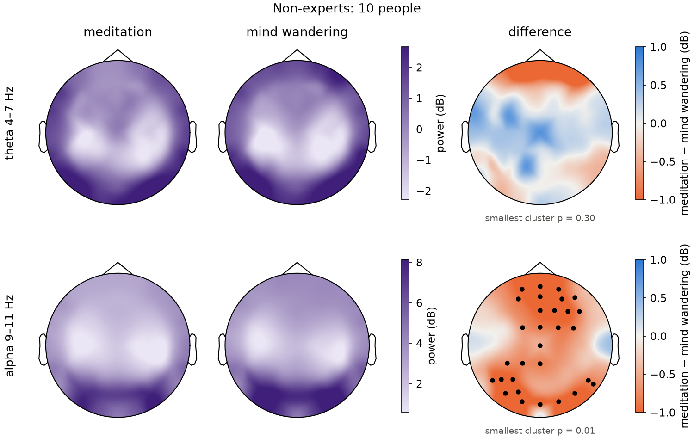
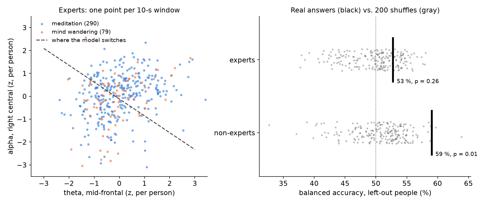

# 03 · Meditation and mind wandering in the EEG

## Question
Can an EEG tell whether a meditator is absorbed in meditation or whether their
mind has wandered off?

## Key result

Each dot is one person: their band power in the 10 s before reporting
meditation, minus their band power before reporting mind wandering (dB). Before
meditation reports, 9 of 12 experts had more theta power over the mid-frontal
region (mean +0.39 dB, about 9 % more; p = 0.04), and 8 of 12 had more alpha
power over the right central region (+0.59 dB; p = 0.09), but the spread
between people is large, especially for alpha. This is the direction, location
and size of the published finding (Brandmeyer & Delorme, 2018), but not its
strength (p < 0.02): without our artifact rule, the theta result drops to
p = 0.10. For the non-experts, theta shows nothing (7 of 10 above zero,
p = 0.19), and alpha is mostly negative: 8 of 10 had more alpha before mind
wandering (−0.47 dB, p = 0.06).

## Data
EEG from 24 meditators of the Himalayan Yoga tradition, recorded at the
Meditation Research Institute in Rishikesh, India (Brandmeyer & Delorme, 2018;
open data on OpenNeuro, ds001787): 12 experts, who had meditated at least 2 hours
a day for a year or more, and 12 non-experts, who were trained but practised
irregularly. They sat with closed eyes for 45 to 90 minutes, started with a body
scan and then silently repeated their mantra.

After every 30 to 90 s of meditation (in the data, a median of 1.6 min from one
question to the next), a recorded voice asked three questions, answered on a
keypad from 0 to 3, all about the moments just before the question:

- Q1 "Please rate the depth of your meditation" (0 not meditating at all,
  3 deep meditative state)
- Q2 "Please rate the depth of your mind wandering" (0 not mind wandering at
  all, 3 immersed in thoughts)
- Q3 "Please rate how tired you are" (0 not drowsy at all, 3 very drowsy)

64 EEG channels (BioSemi) at 256 Hz, 40 recording sessions (one to three per
person), 971 questions. The notebook [`meditation_eeg.ipynb`](meditation_eeg.ipynb)
downloads the data (6.1 GB) into `data/`; the data are not part of the
repository. Python 3.14, numpy, scipy, matplotlib, MNE-Python, scikit-learn
(versions in [`requirements.txt`](../requirements.txt)).

**Tool:** the power spectrum, how much power the signal has at each frequency,

$$P(f) = |X(f)|^2,$$

where $X(f)$ is the Fourier transform of the EEG signal. Rhythms in the EEG come
from many neurons acting in synchrony and show up as peaks in the spectrum
(*Neuronal Dynamics*, Sect. 20.2). The paper's two bands: theta (4–7 Hz) and
alpha (9–11 Hz). Power is compared in decibels, $10\log_{10}P$: a difference of
+0.5 dB means 12 % more power, +3 dB twice as much.

## What I did
1. Worked through the paper and the theory: what the EEG measures, the power
   spectrum, and the theta and alpha rhythms.
2. Downloaded the data (40 recordings).
3. Read the answers from the log files of the experiment program, because the
   EEG file does not say which question an answer belongs to; the clocks of the
   log files and the EEG were matched by the question times. I wrote the rule
   that turns two answers into a state: meditation if Q1 > Q2, mind wandering
   if Q2 > Q1; equal answers are left out, as in the paper.
4. Cleaned the EEG: a 2-Hz high-pass filter, the average reference, two broken
   channels rebuilt from their neighbours, and a rule that drops a 10-s window
   when any channel swings more than 200 µV (eye movements, muscles).
5. Plotted the raw EEG in the 10 s before a question and saw that the state
   cannot be read from it by eye. Split it into frequencies (Welch's method) and
   found peaks in theta and alpha, at first for one person only, which does not
   say much.
6. Looped over all people and compared, for each person, their theta and alpha
   power before meditation reports with their power before mind-wandering
   reports.
7. Drew head maps for experts and non-experts, tested all 64 channels with a
   cluster test, and tested the two regions where the paper found its effect.
   Repeated the tests without the artifact rule.
8. Bonus: asked whether a single 10-s window can predict whether the person
   will report meditation or mind wandering. I wrote the line that compares
   every person only with themself (a z-score per person). Answer: no for the
   experts, a little for the non-experts.
9. Checked two things I noticed about the experiment: tiredness and the time in
   the session.

## Results

### Behaviour
Experts reported meditation in 74.6 % of their answers (mean over people; paper
75.4 %), non-experts in 38.2 % (paper 42.7 %). Two non-experts are left out of
the EEG comparison, as in the paper: one never reported mind wandering, the
other never meditation.

### One expert, one session

At the back of the head (Oz), alpha peaks at 10.5 Hz, about eight times above
its surroundings: the eyes are closed. At the front (Fz), theta peaks at 5.5 Hz.
Before meditation and before mind-wandering reports, the spectra lie almost on
top of each other. With 8 windows of each kind and a spread of 1–2 dB from
window to window, a difference of 0.5 dB cannot show up in one session.

### Head maps

**Experts:** the difference (right column) is blue over most of the head in
both bands: more theta and more alpha before meditation reports. Alpha differs
most over the right central region, as in the paper. Only over the forehead is
theta higher before mind wandering; these electrodes sit just above the eyes,
so eye movements are one possible source (the paper removed them with ICA). No
cluster passes the test (theta p = 0.25, alpha p = 0.20), whereas the paper
found clusters with p < 0.02.

**Non-experts:** theta shows no clear difference (p = 0.30). Alpha, however, is
higher before mind wandering over most of the head, and this cluster passes the
test (p = 0.01). The paper reports no difference for non-experts. The cause is
open; three guesses:
- *Effort.* For non-experts, meditating may still take effort, and focused
  effort tends to lower alpha, while letting the thoughts drift with closed eyes
  is relaxed idling, when alpha is high.
- *Selection by the artifact rule.* The rule dropped 28 % of their
  mind-wandering windows, probably the restless ones, so the calmer ones
  remain. But the effect is still there without the rule (p = 0.05, see below).
- *Tiredness* is a less likely cause: the non-experts were more tired before
  mind wandering (see the end of the results), but drowsiness with closed eyes
  tends to lower alpha, not raise it.

**Artifacts and robustness.** The 200-µV rule drops 139 of 971 windows (14 %),
but not evenly: for the experts 9 % of the windows before meditation reports
and 12 % before mind wandering, for the non-experts 8 % and 28 %. Artifacts and
mental state go together. Without the rule, the borderline results get weaker:

| | with the 200-µV rule | without |
|---|---|---|
| experts, theta region | p = 0.04 | p = 0.10 |
| experts, alpha region | p = 0.09 | p = 0.10 |
| non-experts, alpha cluster | p = 0.01 | p = 0.05 |

For the experts, the direction stays the same in both bands and both versions.

### Predicting the answer from one window

Two numbers per window (theta mid-frontal, alpha right central, each relative
to the person's own mean and spread), a logistic regression, and every person
predicted by a model trained on the others. For the experts, the balanced
accuracy is 53 % (chance 50 %, p = 0.26 against 200 shuffles of the answers):
the meditation and mind-wandering windows overlap almost completely (left). The
difference of about 0.5 dB is small next to the spread of single windows
(1–2 dB); even a perfect classifier could reach only about 56 %. For the
non-experts, it reaches 59 % (p = 0.01): weak, but above chance, in line with
their alpha difference. Their mind-wandering windows also contained more
artifacts, so part of this may come from movement.

### Two observations from the answers
**Tiredness.** I know from my own practice that being tired makes meditation
much harder, so I checked Q3. Compared with themselves, 9 of 12 experts were more tired when
they reported mind wandering than when they reported meditation (+0.31 points
on the 0–3 scale, p = 0.02), and 8 of 10 non-experts (+0.43, p = 0.01). The
paper also reports that mind wandering and drowsiness go together. Tiredness
changes theta and alpha by itself, so part of the EEG difference between the
two states may come from tiredness.

**Time in the session.** My idea was that concentration holds for a while and
then slips, and that practice pushes this moment later. Share of meditation
answers, pooled over the people of each group:

| Minutes into the recording | 0–10 | 10–20 | 20–30 | 30–40 | after 40 |
|---|---|---|---|---|---|
| experts | 73 % | 77 % | 85 % | 83 % | 66 % (38 answers) |
| non-experts | 48 % | 47 % | 51 % | 41 % | 19 % (73 answers) |

The experts get better over the first half hour and drop after 40 minutes; the
non-experts hold at about 50 % and then fall. The paper also finds that the
experts' meditation depth rises over the first 20 questions. Two cautions: the
answers are pooled over people, and only the longer recordings reach the late
times, where tiredness also rises.

## What I learned
- What surprised me is how little you can say. I thought it would be clearer.
  We left out some steps of the paper, but it surprises me that you really
  cannot predict the state well from an EEG. I had expected a clear theta
  difference, because I had read that theta rises during meditation. I wonder
  whether fMRI, which can see deep regions like the default mode network, would
  separate the two states better.
- I learned the positions and names of the EEG electrodes, and how to refer to
  the different areas of the head.
- I learned that in alpha and theta, many neurons work in a common rhythm. I
  find that fascinating. At first I thought strong alpha means the neurons are
  quiet; in fact it means that many of them swing together.
- I criticise the constant questions. I would not want to be interrupted that
  often in my own meditation. From my experience, concentration holds for a
  while, and then the thoughts start to wander; with practice this moment moves
  further back. Every question pulls you out of the moment. You do not start
  from zero again, and getting back in takes far less time than at the
  beginning, but it takes a while. That can help when your thoughts have
  wandered off (which is why I prefer guided meditation), but when I am deep in
  meditation after all the groundwork, it would disturb me.
- A question like "how deep is your meditation?" is hard to compare between
  people: everyone understands "deep" differently.
- I notice how hard it is to study something as subjective as thoughts drifting
  off or attention resting on something, and to make predictions about it. I
  wish it were easier.
- I had expected a bigger difference between experts and non-experts. That the
  non-experts show the opposite alpha effect, more alpha before mind wandering
  over most of the head, surprised me, and I do not understand it yet.
- What interests me now is how attention relates to the default mode network.
  I know the DMN is linked to rumination and mind wandering, but not quite how
  it is studied. That will probably be my next project.

## Limits and next steps
- 24 people, 12 per group, with one to three sessions each. Some experts have
  very few mind-wandering windows (one has a single window, two have three), so
  their averages are uncertain.
- A simpler analysis than the paper's: Welch spectra instead of wavelets, and an
  automatic 200-µV rule instead of manual cleaning and independent component
  analysis (ICA). The paper's p < 0.02 is not reproduced, and the results near
  p = 0.05 flip with this one choice.
- Artifacts, tiredness and the time in the session all go together with the
  reported state, so the EEG difference may partly come from them.
- Everything rests on self-report. "Meditation" is not defined beyond the 0–3
  scale, and the label keeps only which answer was higher: 3 vs 0 counts the
  same as 2 vs 1.
- To report mind wandering, you first have to notice it, and it often goes
  unnoticed; rating the last moments in hindsight is hard. Experts are probably
  better at noticing it, so the non-experts' labels may be less accurate. That
  would blur their EEG difference and makes the two groups hard to compare.
- The questions interrupt the meditation every 1.6 minutes (median), so deep,
  uninterrupted meditation is probably not measured.
- The EEG sees only the synchronous activity of many neurons, smeared over
  centimetres, unlike the single neurons of
  [project 02](../02-mouse-neuropixels/). Deep regions such as the default mode
  network are out of its reach.
- Next:
  - Tiredness: repeat the comparison with only the windows in which the person
    reported no tiredness (Q3 = 0). If the difference stays, it does not come
    from tiredness.
  - Remove eye and muscle artifacts with ICA, as in the paper, instead of
    dropping windows, and check whether the experts' forehead theta and the
    non-experts' alpha remain.
  - Use the answer difference Q1 − Q2 (from −3 to +3) as a number instead of two
    piles.
  - Attention and the default mode network, with fMRI or with EEG source
    localization: probably my next project.

## How this was built
I built this project with Claude Code (Anthropic's AI coding assistant) as a
pair programmer and tutor. The paper by Brandmeyer & Delorme was my starting
point: Claude explained the EEG, the power spectrum and the statistics step by
step, looked up the meditation technique and the exact questions in the paper's
methods, and asked me check questions along the way. Claude also drafted most
of the code, including reading the answers from the log files, the cleaning,
the statistics and the classifier. My part: I wrote key lines myself (the rule
that turns the two answers into a state, and the per-person z-score in the
classifier), criticised the design (the constant questions, the self-defined
depth of meditation), and proposed the two checks on tiredness and on the time
in the session. Claude coded both checks, and we added them to the notebook so
that every number here can be reproduced. The "What I learned" section is in my
own words. Claude also quizzed me in a mock interview.

## References
- Brandmeyer, T., & Delorme, A. (2018). Reduced mind wandering in experienced
  meditators and associated EEG correlates. *Experimental Brain Research*
  236, 2519–2528. https://doi.org/10.1007/s00221-016-4811-5
- Data: OpenNeuro ds001787, meditation experiment (Delorme & Brandmeyer).
  https://openneuro.org/datasets/ds001787
- Gerstner, W., Kistler, W. M., Naud, R., & Paninski, L. (2014). *Neuronal
  Dynamics: From Single Neurons to Networks and Models of Cognition.* Cambridge
  University Press. https://neuronaldynamics.epfl.ch
- Maris, E., & Oostenveld, R. (2007). Nonparametric statistical testing of EEG-
  and MEG-data. *Journal of Neuroscience Methods* 164, 177–190.
- Gramfort, A., et al. (2013). MEG and EEG data analysis with MNE-Python.
  *Frontiers in Neuroscience* 7, 267.
- Welch, P. (1967). The use of fast Fourier transform for the estimation of
  power spectra. *IEEE Transactions on Audio and Electroacoustics* 15, 70–73.
